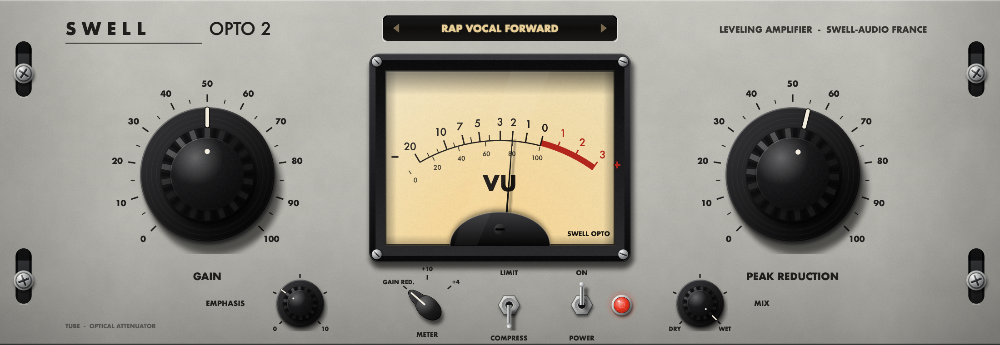

# Swell Opto 2 0.1.0

Nivelleur optique à lampes, façade grise. Commandes : Gain, Peak Reduction, Compress / Limit, Meter GR / +10 / +4, Emphasis, Mix, Power, suréchantillonnage Off / 2x / 4x.

Fabricant : Swell-audio. JUCE 9.0.5. Formats : VST3 et Standalone (Windows), plus AU sur Mac.



## Moteur

Topologie en contre-réaction ; cellule optique modélisée (panneau EL + photorésistance à deux constantes de temps : retour rapide jusqu'à mi-course puis lent, 0,5 à 5 s selon la durée de compression), Limit plus raide, Emphasis = aigus accentués dans la commande, étage à lampes (H2) et saturation des graves du transformateur.

Commun : suréchantillonnage demi-bande IIR polyphase (latence entière compensée, changement sans allocation),
mix parallèle aligné sur la latence, bypass progressif par l'interrupteur Power, détection stéréo couplée, lissage des paramètres.

## Presets

Presets d'usine classés Vocals / Drums / Bass / Instruments / Bus, aussi visibles comme « programmes » dans l'hôte.
Afficheur rétroéclairé sur la façade : ‹ › précédent / suivant, clic sur le nom = menu complet.
Presets perso (`.swellpreset`) dans `Documents/Swell Audio/Swell Opto 2 Presets`. Un preset ne change que le son
(Power, suréchantillonnage et sélecteur du vu-mètre restent en place).

## Licence Swell

Module commun `Source/Licence` (copie identique à celle des autres plugins Swell). Slug boutique : **`swell-opto2`**
(`Source/LicenceConfig.h`). Sans licence : silence et écran d'activation par-dessus la façade.

## Interface « matériel réel » sans images

Rien n'est importé (ni PNG, ni SVG, ni filmstrip) : tout est calculé par le code.

- **Textures procédurales** : aluminium brossé (stries floutées de façon anisotrope + reflet en bande), peinture grise marbrée,
  grain de papier et de plastique. Calculées une fois au démarrage.
- **Lumière fixe** comme sur une photo : les boutons tournent mais leurs reflets restent en place ; les cannelures
  s'éclairent selon leur orientation face à la lampe.
- **Ombres douces** (portées et de contact), verre du vu-mètre avec reflets, carter du galvanomètre, vis, rondelles,
  rails de rack visibles dans les fentes, inverseurs chromés, voyant à cabochon taillé avec halo.
- **Aiguille VU physique** : galvanomètre masse-ressort amorti (≈ 300 ms, ≈ 1,5 % de dépassement), butées avec rebond,
  animée à la fréquence de l'écran (VBlank). L'ombre de l'aiguille se déplace sur le cadran.
- **Performance** : tout ce qui est fixe est rendu une fois en cache à la résolution physique de l'écran (Retina compris) ;
  seules les pièces mobiles sont redessinées. Interface redimensionnable de 50 % à 200 %, toujours nette, taille gardée dans la session.

## Compiler

```bash
cmake -S . -B build -DCMAKE_BUILD_TYPE=Release
cmake --build build -j
```

Pour compiler hors ligne avec une copie locale de JUCE : `-DFETCHCONTENT_SOURCE_DIR_JUCE=deps/juce`.

Outils : `TestOpto2` (stabilité, compression, transparence à Mix 0 et en bypass, 3 facteurs de suréchantillonnage,
réglages extrêmes, état, silence sans licence, chargement des presets d'usine, presets perso) et `SnapshotOpto2 <sortie.png> [échelle] [locked]` (capture de l'interface, `locked` = écran d'activation).

Licence JUCE : JUCE est sous AGPLv3 ou licence commerciale ; vendre ce plugin en code fermé demande une licence JUCE commerciale.
Nom et façade propres à Swell : aucune marque, aucun logo ni aucune sérigraphie d'un fabricant existant.
